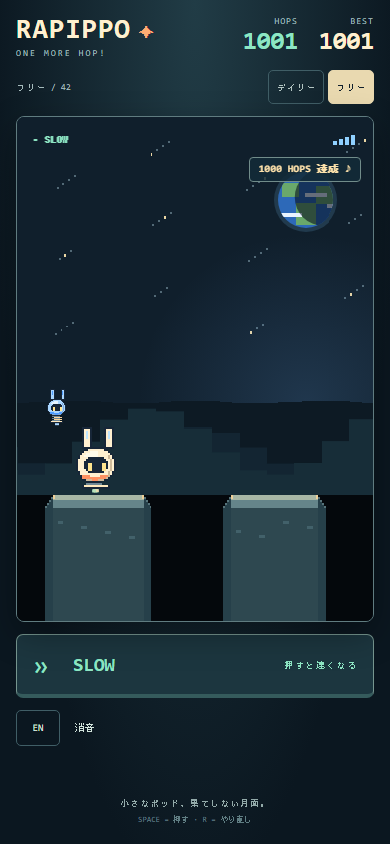
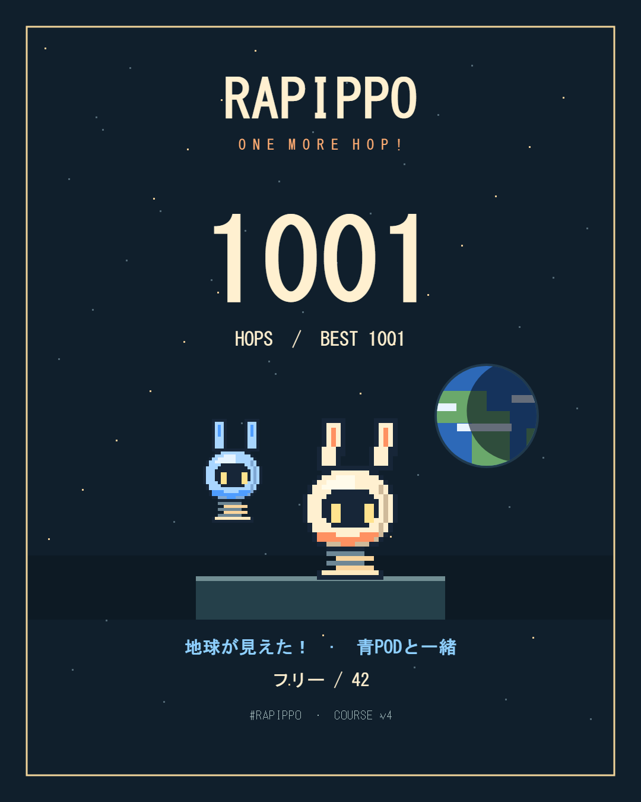

# RAPIPPO 統合前最終監査 / 2026-11-01 JST

## 1. 総合判定

**FIX REQUIRED（#1〜#13だけを取り込む場合）。本監査の最小修正を含めた最終スナップショットはmain統合READY。検証は72 Node / 38 browser。公開は別判定。** 美術トラックA/B/Cの未着手や収益化の未実装を、main統合の阻害理由にはしない。

GitHubを照合した対象は `docs/concept-art-direction` / #13 の `e6645d4546f91592ffc5f489fc14d627d754e744`。mainは `f50befbd326cbc62c1b0d270e20f85fc5b94c6c9`、内容はREADME一枚だけだった。ローカルは#13と一致し、開始時に未コミット変更はなかった。`git fetch origin --prune` 後も一致した。作業は `codex/rapippo-final-audit` に分離した。

全13本はopen/Draft/未マージ。各head/base/SHA/CIは [スナップショットJSON](audit/pr-snapshot.json) に固定した。各baseはheadの祖先で、前PRのheadと次PRのbase SHAが一致する。mainから#13まで66コミット。各PRのbase→head差分を作成して変更ファイルと最終実装を照合した（再現用patchは `output/audit/pr-1.patch`〜`pr-13.patch`）。

## 2. 統合前に直す不具合と修正

### P1 — 設定クリック後、Spaceが速度操作にならない【修正済み】

場所: `public/src/app.mjs` のSOUND・言語clickとkeydown。

再現: START → 日本語/ENまたはSOUNDをマウスでクリック → Spaceを押す。設定ボタンにフォーカスが残り、ゲーム側keydownがBUTTONを除外するためFASTにならない。ブラウザによってはSpaceで設定を再度切り替える。進行中に操作が効かず落ちる原因になる。既存テストは切替直後のHOPS/overlayだけを検証し、その次の操作を検証していなかった。

修正: 設定を実行するときにそのボタンのフォーカスを外す。START後にゲーム操作へ戻す既存処理と同じ方式。UI、物理、進行、言語保存の仕様は変えない。修正前のブラウザ回帰テストはFASTではなくSLOWで失敗し、修正後は両設定から次のSpaceがFASTになる。

### P2 — 旧マーカー単独URLが正式C方針より広い【修正済み】

場所: `public/src/marker.mjs` と `tests/marker.test.mjs` / `tests/browser/marker.spec.mjs`。

通常のパラメーターなし画面は以前からCで正しい。しかし `?marker=full` / `neutral` だけで比較UIのない画面にも予測表示を出せた。#8の旧実験仕様をテストも正しいと仮定しており、#13の「通常はC、研究は `marker=…&compare=1`」という正式方針より条件が広かった。

修正: A/Bは `compare=1` との組合せだけで有効にし、単独の旧URLはCへ正規化する。明示比較は維持する。Cの既存BESTキー、A/B研究記録、DAILY、コースv4は変更しない。新規テストの失敗を確認してから、正式方針に従い旧テストの期待値と研究用URLを更新した。予測関数自体は研究テスト・物理検証に使用するため削除していない。

### P2 — 部品を取り逃す長いランで、影の地形とスロットが増え続ける【修正済み】

場所: `public/src/parts.mjs` のPartLayout / PartRun、およびappのretry。

再現: seed 42で400スロットを順に取り逃す。元コードは `slots=401`、影の足場7,779、参照点10,941、モチーフ2,734を保持した。本体のTerrainだけはtrimされるため、既存の10,000ホップテストはこの別Terrainの増大を見落としていた。配置時の足場探索も過去全体を走査し続ける。通常の短いランですぐ破綻するという意味ではないが、エンドレスとして修正すべき保持データ増大である。

修正: 生きたPartRunが通過/取得した位置で影のTerrainをtrimし、スロットは最初のトレイ用1件と直近分だけ保持する。古いスロットを研究用途で問い合わせる場合は独立した一時生成で再現し、生きた乱数列は動かさない。リトライは同じseedの新しいlayoutを作る。

同じ400 miss後はスロット4、足場21、参照点28、モチーフ7になった。修正前#13から採取した5 seeds（0/1/7/42/uint32最大）×100スロットのSHA-256を固定し、手動問い合わせと実際のmiss進行の両方で配置と順序の完全一致を確認。部品を再抽選・移動した修正ではない。

### 変更しなかったもの

`engine.mjs`、`links.mjs`、`audio.mjs`、`earth.mjs`、`companion.mjs`、`pod.mjs`、`ui-copy.mjs` は監査対象#13と差分なし。0.78秒、105/270px/s、地形v4、20モチーフ、部品の位置/取得幅、スコア、音の設計、地球閾値、DAILYの `HOPPOD-` salt、`hoppod.best.v4.*.marker.off` の記録を保った。金色ビーコンや自動30-HOPS加入は復活させていない。

## 3. 軽微な改善候補

| 候補 | 判定 |
|---|---|
| 結果画面で地球・仲間がoverlay越しに暗い。PNGは明瞭 | 後の美術トラックC。統合前必須ではない |
| 日本語の小さな補助ラベル、36px程度の設定タップ領域 | 実機で確認。現時点で操作不能や文字欠けは検出せず、拡大を統合条件にしない |
| 初見に「狙って部品を取る」意味が伝わるか | 初見試遊が必要。恒常マーカーを戻す根拠にはしない |
| 200 HOPS以降は地球の高さが飽和し、自己記録が主な動機になる | 現行エンドレス仕様。追加ステージ・仲間・敵を今回の条件にしない |
| 公開OGP、実際のXアプリでの手動PNG添付、公開URL | 公開前チェック。ローカルでの保存とcomposer引数の検証とは別 |
| package version 0.3.0、CI名HOPPODなど内部の古い呼称 | 内部識別子。RAPIPPOの表示名やv4地形/BESTの正しさを損なわず、今回変更しない |

## 4. 独立検証と結果

### ベースライン

#13のコードで **67 Node / 33 Chromium browser成功、skipなし**。#6の最新CIだけは歴史的な失敗のままだが、#7以降の最新CIは成功している。#6だけを抜き出して統合不可とは判定しない。今回も最終スタック全体で再実行した。

### 追加検証

- **独立したブラウザ1001 HOPS**: 参照Terrain・参照plan・PartRunの双子で操作を決めず、実Canvasの明るい足場のピクセルから安全区間を読み、足元の青ピクセルが届く範囲にあれば狙った。実際のキーボード入力と制御時計で100/300/1001を通過し、3種の部品を取得・組立・追従した後、画面の穴へ本当に落下した。終了スコアは1001。
- 100時点は部品1種、300・1001時点では完成していた。意図した参照ルートの最短完成回数をなぞるだけのテストではない。取り逃し後の次スロットと、他の足場へ寄った経路でも取得できることを検証した。
- 同ランでJA/ENを切り替えても位置・HOPS・overlayは変わらず、1001 HOPS / BEST / 地球 / 完成仲間が載る1080×1350 PNGを両言語で実保存した。Xに渡す正確なseed=42/v4のURLとBESTの既存キーへの保存を確認した。実際のX投稿はしない。
- 通常音・10/50/100の階層、ベル・pickup・bootの区別と停止は既存音声/ブラウザテストで再検証。追加で実OfflineAudioContextに100の和音・通常着地・pickup・boot・bellを同時に予約した。最大振幅は約0.09884（クリップ上限1.0）、途中ミュート後130ms以降の出力は0。実スピーカーの歪みや音の好みまで証明した値ではない。
- マウス設定後のSpace、Chromiumの二指タッチ（HOLD中に別の指が設定領域に触れても元の入力を失わない）、単独設定タップ、touchcancelを確認。Android端末を触った検証ではない。
- ±20pxの部品取得両端、±20.001pxの外側、重複取得なし、3種未満で完成しないことを確認。既存400-seedの配置/到達可能性/収集検証も維持する。
- 320×568、320×640、390×844、Pixel 5相当、PC、横画面を再確認。0/1/full crewの実保存PNG、2部品状態のプレイ画面、JAの高記録PNGを目視した。日本語の複数文字が同じ欠字箱へ潰れない簡易ピクセル検査も加えた。全Unicode字形や全端末のフォント保証という意味ではない。
- 30/60/120/144Hz、512 seedsの描画/足場境界、非参照160,000着地、本体保持データ上限、日替わり再現性、BEST・言語・サウンドの保存、ぼかし/非表示/ポーズ/再開/リトライを再実行。
- **端と中央だけを共有する前提への追加監査:** 256 seedsを50,000pxまで生成し、全足場内部を1.7px刻みで5,431,646点走査。正の次着地先がない点は0。既存の「端/中央の20px余裕」は全内点の20px保証ではなく、今回の最小連続区間は約10.4px（seed 254、約30,190pxの地点）だった。SLOW/FAST端の入力を継続できる区間も含み、即「31msで正確に切り替えなければ死ぬ」と解釈しない。到達不能の新バグではないため、地形/DAILY/BESTを変えて20pxへ合わせる修正はしなかった。

1001までの保持数（最終ランの例）:

| HOPS | 本体足場/参照点 | 影の足場/参照点 | 部品slot | 取得 |
|---:|---:|---:|---:|---|
| 100 | 9 / 13 | 23 / 33 | 4 | 1種 |
| 300 | 12 / 13 | 4 / 4 | 3 | 完成 |
| 1001 | 10 / 13 | 4 / 4 | 3 | 完成 |

一方で「ずっと取らない」場合の上限は、400 missの別回帰テストで検証した。長期ランを消音で短縮実行したため、音声の実時間負荷とは区別する。描画要素数と保持データに進行依存の増大はなくなったが、Androidの発熱・電池・実フレーム時間は未測定。

### 最終コマンド

```powershell
npm test
npm run check
npm run check:assets
npm run test:browser
```

Node **72成功・skipなし**（71件成功後、独立した内点走査1件を追加して全件を再実行）、Chromium browser **38成功・skipなし（フル実行7.2分）**、構文とasset dry-run成功。内点テスト・資料の追記後にゲームコードは変更していない。証跡は `output/audit/`、従来分は `output/playwright/` / `output/review/`。CIは3フォルダをartifactに含める。ローカル/CIともブラウザコマンドを同時実行しない。

Cloudflareは既存Wrangler設定と固定CLIを使用したdry-run・ローカル配信のみ。`/dev/sfx.html` と `.assetsignore` は404、通常アセットは200を再確認する。ローカルだけ互換日10/30を指定する既存の制約は維持し、本番設定10/31やアカウントは変更していない。実アップロード・本番実動作は未確認。




## 5. 完成形とのギャップ

橙/クリームの主人公、足場上の青い部品、3枠の進捗、完成後に左後ろへ付く小さな青POD、地球が同時に読める。仲間は主人公の40px後ろに位置し、前方の着地判断領域を塞いでいない。組立の軌道もトレイから左後方へ向かい、ポーズを要求しない。部品の3種を集める目標が「単に数字を増やす」以外の旅の理由になっている。人間試遊で選ばれたCと部品方式を維持する構成として、致命的な画面の混雑は見つからなかった。

これは人間の楽しさをモデルが認定した結論ではない。既存の人間の「面白い・癖になる」「仲間がかわいい・集めるのが楽しい」という採用判断を尊重し、今回のスクリーンショット/合成入力と分けて扱う。美術方針の参考画像は高密度のムード資料であり、ゲームへそのまま写す必要はない。まだ採用されていない基地・流星・追加PODを「不足機能」として要求しない。

収益化（広告・決済・有料販売）は未実装。無料で軽く共有する現状の目的に対して、収益化やオンラインランキングを統合条件にしない。公開はCloudflareの本番URL、OGP、実機とXの確認・必要なクレジット確認が残る。BESTは採用仕様どおりゲームオーバー時に保存し、途中でページが強制終了した場合の新記録保全はしていない。

## 6. PR別整理と推奨統合方法

各行のCIは監査開始時のheadを対象にした観測値。すべてDraftである。

| PR | head短縮 | base | 最新CI | 最終状態での扱い |
|---:|---|---|---|---|
| #1 | 01d190e | main | 成功 | 基盤を採用。初期UI/仮絵/旧地形を再適用しない |
| #2 | 3cca8ab | #1 | 成功 | 操作感・共有・検証を採用。v2形状/リングは後続で置換 |
| #3 | 9d95ea4 | #2 | 成功 | 公平な足場・記念音を採用。v3 namespaceを復活させない |
| #4 | 6f208ad | #3 | 成功 | 地球の距離演出を採用 |
| #5 | 566df40 | #4 | 成功 | 音声停止・公開対象検証を採用 |
| #6 | c7233a8 | #5 | 失敗（歴史） | 20モチーフを採用。#7のブラウザ修正を含む最終状態で統合 |
| #7 | d3fbaa9 | #6 | 成功 | #6のテスト修正と研究用比較を採用。A/defaultは#8で廃止 |
| #8 | ff65b6e | #7 | 成功 | 正式Cを採用。本監査で研究URLを明示比較に限定 |
| #9 | 80f9124 | #8 | 成功 | POD描画/ベルの基盤を採用。自動30加入は#11で置換済み |
| #10 | 6e880a9 | #9 | 成功 | RAPIPPO表示名を採用。内部HOPPOD識別子は保持 |
| #11 | 638cf38 | #10 | 成功 | 3部品方式を採用。本監査の保持データ修正を含める |
| #12 | aa79fe6 | #11 | 成功 | JA/EN・音設定・ビーコン撤去を採用。本監査のSpace修正を含める |
| #13 | e6645d4 | #12 | 成功 | 正式方針を採用。5変更ファイルは文書/参考画像のみ |

置換済みなのは**挙動**であって、#7や#9のPR全体が不要なのではない。その祖先コードを丸ごと除外すると、後続が使うモジュール・音・テストも失われる。重複したゲームループや二重の自動仲間加入は最終ソースに残っていない。旧テスト名のv0.2/v0.3は履歴上の名前で、実際のimportは現在のエンジンを検証している。

### 推奨：最終headを1本の統合PRにし、一度だけsquash mergeする

ソース依存順は **#1 → #2 → #3 → #4 → #5 → #6 → #7 → #8 → #9 → #10 → #11 → #12 → #13 → 本監査修正**。ただしmainへの取り込み単位は13回に分けず、監査修正まで含んだ最終headをbase=mainの新しい統合PRにする方法を推奨する。**この監査では統合PRの作成やマージは行っていない。修正Draftだけを提出する。**

根拠:

- 現在mainは最終headの祖先。分岐したmain変更はなく、現時点で内容の競合はない。最終ツリーを一つの候補としてそのまま比較できる。
- 試遊・監査したものは最新スタック全体。#1の旧UI、#7のA/default、#9の自動加入をmainへ一時的に公開する必要がない。
- #6の単独CI失敗を無駄にbackportするのではなく、#7の修正を含む候補で検証できる。
- 1本のsquashならmain上は一つの原子的な導入となり、問題時のrevertもしやすい。元の13 PRとソースブランチは検討履歴として残す。
- 13本を個別にsquash/retargetすると、祖先関係が変わり、次の比較に過去差分が再表示されるなど再審査・競合解消の作業が増える。一方、個別mergeは各PRの採用履歴がmainに明瞭に残る利点があるが、今回は実験の中間状態を採用したいわけではない。

承認後の具体的手順:

1. #1〜#13と監査修正のSHAを固定し、元ブランチは更新・削除しない。
2. 修正Draftを確認し、mainが監査時の `f50befb` のままか再取得する。進んでいれば統合候補に最新mainを取り込み、競合と最終ツリーを再監査する。
3. 最終headから新しい統合ブランチを作り、base=mainのDraft統合PRを一つ作る。中間コミットを手動で再実装・cherry-pick・旧コードで上書きしない。
4. そのPRで全72 Node / 38 browser、asset dry-run、正式方針/画像/PNGを再確認し、チェック済みheadをユーザーが承認する。
5. 承認後に一回のsquash merge。元の#1〜#13と修正Draftは、統合PRに置換された旨を確認してから整理する。squashでは個別PRがGitHub上で自動的にmerged扱いになるとは限らないため、先に閉じない。
6. mainで最終スモーク（起動→数回着地→部品→落下→retry、JA/EN、音、保存、seed）を再実行。本番公開は別途判断する。

## 7. 人間による最終確認

**main統合と一般公開を分ける。** コード統合を細かな美術で遅らせない一方、以下は自動テストで済ませたとはしない。

- #8/#13に残る初見プレイヤー3人の確認: 押す/離すを理解し、最初の穴の失敗理由を説明できるか。青い部品を「狙うもの」と気付き、取り逃し後の再登場が不公平に見えないか。
- 実Android縦画面: 長押し、離す、設定タップ、cancel、回転、バックグラウンド、復帰、音の解錠/ミュート保存、JA/EN、PNG保存。Pixel 5相当テストは実機ではない。
- 実スピーカー/イヤホン: 通常着地、記念音、pickup、boot、ベルを区別でき、完成後のベルが疲れないか。ミュート/リトライ/ポーズ後の残音も聴いて確認する。
- 公開予定URLで、Xアプリ内の起動・同日/同seedの再現・保存PNGの手動添付・OGPを確認する。localhostリンクを公開リンクと取り違えない。
- 高記録と0/1〜2/3部品の結果で、「自分の旅」として撮りたくなるか。必要なら正式な美術トラックCで磨き、余分なPODを装飾として足さない。

## 8. 提出物と文書差分

提出ブランチは `codex/rapippo-final-audit`、baseは#13の `docs/concept-art-direction`。[修正Draft PR #14](https://github.com/madowaku/hoppod/pull/14)に本報告・CI・スクリーンショットをリンクする。既存Draft、main、Cloudflareの本番状態には変更を加えていない。

- **README**: Project directionのlanding preview、A/default、自動30加入、旧v3を現行説明と読める状態だった。#13の正式方針と最終コードに従い、現行v4/C/3部品/JA-ENの冒頭案内を追加し、既存の各実験文は「歴史・現行仕様ではない」とまとめて保存した。
- **`docs/V04B_NO_MARKER_DEFAULT.md` の単独marker URL / 旧markerテスト**: #13を優先し、実装・テストを明示比較との組合せだけへ狭めた。歴史文書は当時の記録として残した。
- **`docs/V04C_COMPANION_POD.md` の自動30加入 / `V04C2_BLUE_POD_PARTS.md` の金ビーコン記述**: #11/#12で置換・撤去済み。正式方針と最終実装に従い、復活させない。旧文書は履歴であることをREADMEから明確化した。
- **`docs/V04C2_BLUE_POD_PARTS.md` の22〜32ホップ間隔**: コードのslot.hopは参照ルート上の番号で、実プレイヤーのHOPSや秒数と常に同じではない。実装の固定距離・配置を維持し、文言は参照ルートの目安として扱う。配置を変えて説明へ合わせていない。
- **古いv0.3資料とテスト名**: v3の閾値や検証件数は当時の結果で、現行の版はエンジン定数4。保存キー・DAILY saltは改名せず現在の実装を維持した。
- **CIの手書き構文チェック一覧**: companion/parts/ui-copyを追加するたびに同期されていなかった。現行 `npm run check` に統一し、audit証跡もartifactに加えた。Node importテストでも構文は検証されていたため、これだけを既存CI成功の否定材料にはしない。
- **Wranglerの互換日**: 本番config10/31と固定workerdの対応上限10/30の差は既存の検証制約。ローカルだけの上書きを維持し、本番実ランタイム・実機・公開X/OGPは未確認のままと明記した。

採用済みのゲームルールと資料が食い違う箇所を、旧資料に合わせて巻き戻した変更はない。
