# RAPIPPO STORY — thatgamejam #02

**Draft; not merged or deployed.** Branch `feature/story-jam-02` from `main` (53b6642). Deadline: 2026-11-08 16:59 JST.

STORY is a separate page (`public/story.html`) and module set (`public/src/story/`). FREE RUN, DAILY, BEST keys, course v4 and physics are untouched. FREE RUN changes: a `STORY ›` link in the mode row, the entry rule and the language rule (see *Release entry and language*). STORY imports the engine's constants, `footing` and the pod artwork read-only. The v0.5 mastery lab was used as reference only (its timestamped-input idea); no lab code or gates were brought in.

Play locally: `npm run dev`, then open `http://127.0.0.1:8000/` (the bare address opens STORY). Developer start points: `?cp=N` (checkpoint N), `?cp=end` (ending only), `?lang=ja`.

## P0 — one clock for hops and music

| Decision | Why |
|---|---|
| `BEAT = PERIOD = 0.78s` exactly (76.923 BPM). Hops land at `k × BEAT` from absolute story time, not by accumulating frame deltas. | No drift over five minutes; a touchdown *is* a beat. |
| Story time S = **heard** audio time minus an offset. Heard time = `getOutputTimestamp()` mapped to `performance.now()`, else `currentTime − outputLatency`. | Physics and drawing follow what is coming out of the speaker, so Bluetooth latency shifts nothing visible relative to sound. |
| Notes are scheduled 150ms ahead on the context clock at `contextTime(S) = S + offset`, on a sixteenth grid (`BEAT / 4`). | Frame drops never delay a note. |
| Small timestamp jitter slews (12%); >80ms disagreements snap; time never runs backwards. | Unit test: ±6ms jitter with 210ms latency stays within 8ms of the heard beat. |
| No running context (blocked, suspended, interrupted) → performance time, **rebased** so S is continuous; it rebases back when audio returns. | Muting only zeroes the master gain; the clock never stops for mute. |
| Pause (Esc, blur, hidden tab, pagehide, a >0.5s frame gap) freezes S and cancels scheduled notes; resume continues from the exact beat phase. | |
| Input edges use the event `timeStamp` mapped into S and split the simulation at those instants (`TimedInput`). | Identical result at 23/30/60/144fps and jittered frames (unit test replays the full witness). |

Not measured yet: real touch/dispatch latency on Android, and whether `getOutputTimestamp` is stable on the target phone. Check on device in P5.

## P1 — the full skeleton

Fixed course, five chapters, eleven checkpoints (one added past the crane in P3). A fall plays for two beats and respawns on a beat at the last checkpoint; **progress with friends is never lost** (parts stay collected; a green behind is restored next to the hero; once green holds the bridge it stays).

| Chapter | Mechanic in the skeleton |
|---|---|
| ① WIND-UP | Dark; light radius around the hero pulses on each touchdown; footing edges always glint. Three blue parts (±36px). A missed part hops ahead; after two misses it flies to you. Assembly opens the light over 3s and the bell enters. |
| ② APART | Green floats at 160px/s (SLOW 105 < green < FAST 270): FAST pulls away, SLOW lets it catch up. Beyond 150px (the ring) the link breaks and green stops. See P2 below. |
| ③ FETCH | Red wakes and rides the crane's beam; the span is solid on two of every four beats (always solid after two falls there, and locked down once red has left). Across the crane red looks back for one beat and leaves on its own. See P3. |
| ④ BASE | Three station islands: landing on each leaves that friend at its station, touching down on the beat with the hero. Landing on the dock stops the hero. |
| ⑤ SEND | See P3/P4: the stop, the hand-off, the rocket's window, four lights, black at D+63; `RAPIPPO` +65; end card +73. |

Length from the solver witnesses: dock at 167–216s depending on pace, plus a 56s ending → **3.7–4.5 minutes** before falls.

## Review round 1 (PR #16)

- **"B5 is missing" (music):** not reproduced. `B5: 987.77` was already in the note table at bf531da (between `A5` and `C6`); every note had a finite pitch. A test now checks pitch, length and level of every note the composer emits across 1,500+ notes and three song states.
- **Launch rumble cut at 0.5s:** confirmed and fixed. The noise buffer now loops, and the rumble has its own swell → hold → fade envelope (the old exponential decay was inaudible after ~4s). Offline render: RMS at 5–6.5s is now higher than at 0.4–1s.
- **Sound effects late on Bluetooth:** confirmed by design review and fixed. The audio side now works on a **predicted run**: each frame the run is simulated ahead to `currentTime + lookahead` with the current input held. Cues (pickup, assembly, join, link lost/restored, switch, fall, respawn, station, dock) are scheduled at the context time of their event, and the tick is skipped on a beat predicted to be a fall. An unpredicted event still sounds immediately (counted as "late" in tests). Limit: an input change within the last latency window before a touchdown can, rarely, make a predicted cue wrong.

## P2 — blue and green

**Blue: out of the dark.** The third part triggers a white flash, a ring of light rolling out from the lamp, the slow wide chord under the boot chime, and over 3s the darkness lifts to reveal a horizon glow and a far mountain range with lit rims that was never visible before. Blue keeps a soft pool of light under it.

**Green: you left it behind.** Range is now **150px** (was 240) so the ring, green, and the moment it drops out sit at the hero's left. The camera slides at most 11px for a lagging friend (P3: 50px could push a full FAST landing, HERO_X + 210.6px, off the 360px screen); past that the ring and the edge marker show the friend left behind.

- Signal shown three ways: the dashed link line, three bars over green, and the range ring (brightens as green nears the edge). Near the edge both flicker.
- Link break: a small spark where it snapped, a falling three-note cue, bars drop to zero, green's eyes go dark and its antenna tips turn grey, a blinking ✕. Off screen, an edge marker remembers it while its music can still be heard.
- Bass by distance: inside the ring full and clear, thinning at the edge; beyond, a faint low-passed "radio" that fades out over ~4 ring widths (also when green is on the switch).

**Learning the rule before it matters.** The valley (four stepping stones, ~0.77 FAST on average) **always** breaks the link once: tested on every feasible route. A relay antenna on the rest ground after it reconnects green (rings, a rising cue, green flies back). The rule is experienced safely before the switch.

*Superseded by "Green's socket" below (2026-11-03).* **The switch, without words.** The switch is a socket drawn in green's shape. Whenever green floats over it while following, the socket glows and the bridge's first planks stir: the player sees "green here → bridge" before ever leaving green there. Leaving green within 70px of it (+30px per respawn) opens the bridge; the planks run out over one beat. After one fall there green lingers a little over its socket; after two it almost stops, so SLOW alone works. Novices cannot get stuck; the solution is still shown, not told.

Discoverability, honestly: the valley teaches "FAST → green drops out" and "relay → back", the socket teaches "green here → bridge". Joining the two ("so drop it *here*") is the real leap; most first-time players will fall once, then see the socket glow again. Needs a human first-play test (P5).

## P3 — red, the reunion, the stop, the rocket

**Red decides by itself.** Red rides the crane's beam while it works the span, so it is in view as the hero crosses. The far side is a long, plain platform (420px), so the next beats need no judging while it happens. There red drops beside the hero and, for exactly one beat, pings back towards where green was left (two red arcs, a rising two-note cue). On the next beat it sets off left, slowly at first (closed-form acceleration over one beat, then 900px/s), with a streak and its own dashed signal ring, so the player sees it leave unasked. While red is off screen a small **comms window** (top left, red frame, scanlines) shows the far end: green alone and dark on its socket, red arriving, a red ring as green's eyes light again, the pair lifting off. The window closes once they are on their way; an edge marker (red with green under it) stays until they arrive. No cutscene: the hero keeps hopping throughout.

**The reunion is the music coming back.** When red leaves, its percussion fades with distance until only the tick and the bell remain. From the pickup, bass and percussion return through red's link: a faint radio (level 0.27, ~0.5kHz low-pass) that clears with every hop on a log-distance curve (0.27 → 0.71 at ~2.9kHz → 0.90 and full 12kHz when they arrive). The reunion cue and three-colour rings mark the moment, but the change is the song itself filling back in.

**The first stop (D → D+1).**
- D: the hero lands on the dock; a connector drops onto its head in 0.2s, a gold ring spreads on the deck, the dock "clunk" plays, and every part falls silent. The friends at their stations stop bouncing and hold still. The camera pulls back during this beat so the whole base is in view by D+1.
- D+1, the beat the next touchdown would have been: blue touches down on its island with a blue ring, the bell plays with a low G under it, the hero's light blinks for the first time and the mast sends out its first ring.
- D+5 green (P4: on the next downbeat) touches down with the bass; D+9 red with the percussion. From then on the three land on every beat and the hero's light blinks on every beat (0.12s on, at k × 0.78s). Nobody hops for the hero; the music goes on.

**The rocket's window.** D+17 launch (P4) (rumble) and the camera follows the rocket up; D+20.3–22 a dip to black; then the view opens inside a round window looking back down at the base. The base shrinks (zoom 0.55 → 0.19) and sinks in the window while the moon's horizon curves; platforms show only their lit tops. The music thins and muffles with distance but never stops before black (floor 12%). Blue, green and red lights plus the hero's blinking one stay on screen; the camera never turns away; black at D+63.

**Phones.** At 390×844 (the Playwright viewport) the four lights end about 22–25 CSS px apart (asserted > 14px): 3px dots with 7px halos, inside the window.

### Switch assist, revised (P2 follow-up)

*Superseded: the new socket rule needs no assist (see "Green's socket").*

The old assist let SLOW alone solve the switch after two falls. Now each fall at the switch:
- widens the socket's catch zone (70 → 100 → 130 → 160px) and draws it on the ground as a green band with end ticks;
- from the second fall, makes the socket pulse on every beat while the hero is on the field;
- slows green over the zone to 125 / 112 / 106px/s: never below SLOW (105), so SLOW alone still keeps green beside you and the FAST burst stays the player's.

Single-burst plans that work (8 start hops × 4 holds × 1–2 hops): 4 → 9 → 12 → 14 of 64 for 0–3 falls. Green also announces its socket: a soft two-note ping on the next beat when it floats into the zone. **Safety net:** after the 4th fall green settles on the socket by itself (SLOW alone works; 50/64 plans), so nobody is stuck.

### Never stuck; RANGE 150 audit

- **Fixed (blocked progress):** a fall after red had left the crane respawned the hero before the crane, where the span no longer moved. The span now stays down once red has gone, and a checkpoint sits on the far platform.
- A third relay at the switch field's edge reconnects a green lost on the approach, so green never reaches the field unlinked by accident.
- Falls forced at each moment (before the crane, red looking back, flying, carrying green, just reunited, between stations): the crew comes back consistent (a red in flight resumes carrying green from behind the checkpoint; the crane stays down once red has gone; the bridge stays open) and the dock stays reachable.
- Noisy play test: four seeds, a look-ahead player with 12% random holds. 70 respawns; after each one the solver reaches the next checkpoint. All 9 strandings were in chapter II before the bridge (none in I, III, IV: green only follows unlinked in II).

### Friends built for their jobs (P4 groundwork)

Same face, different job: see [CREW_SPRITES.md](story/CREW_SPRITES.md). Blue has a lamp above its ears, green wide foot pads, red a folded side arm. Each transforms while it works (light mode, anchor, crane), and Rapippo becomes the transmit tower on the dock. Shared `pod.mjs` is untouched (FREE RUN unchanged).

## P4 — wind-up, waking, widening, flight

- **Music:** a new 16-bar composition (G major with a borrowed C minor), a melody that breathes, a bass that walks, a groove with fills, a pad that exists only once all four are together in the ending, and glints for the rocket. Previews render to WAV with the game's own code. See [MUSIC.md](story/MUSIC.md). A click bug since P0 (new gains starting at 1) is fixed.
- **Blue's awakening:** chapter ① runs under a low, ragged rock ceiling. When blue is built it lifts away over three seconds as the light opens: the sky, the far range, the horizon glow and, on the far ridge, the base's lights (where the road goes). The ceiling never reaches the ground; landings read the same.
- **Crew forms:** Rapippo's transmit form now also folds out two fixed legs. See [CREW_SPRITES.md](story/CREW_SPRITES.md).
- **Ending gates** move to downbeats of the song that restarts on D+1: bass D+5, perc D+9, pad D+13, launch D+17, black D+63.
- **Phone load:** 390×844 at DPR 3 with the CPU throttled 4×: 60fps in the dark start, chapter II, the rescue window and the rocket window (mean 16.6ms, p95 ≤ 16.8ms, 0 frames over 33ms). Headless Chromium; GPU raster cost is not emulated, so a real Android check remains.

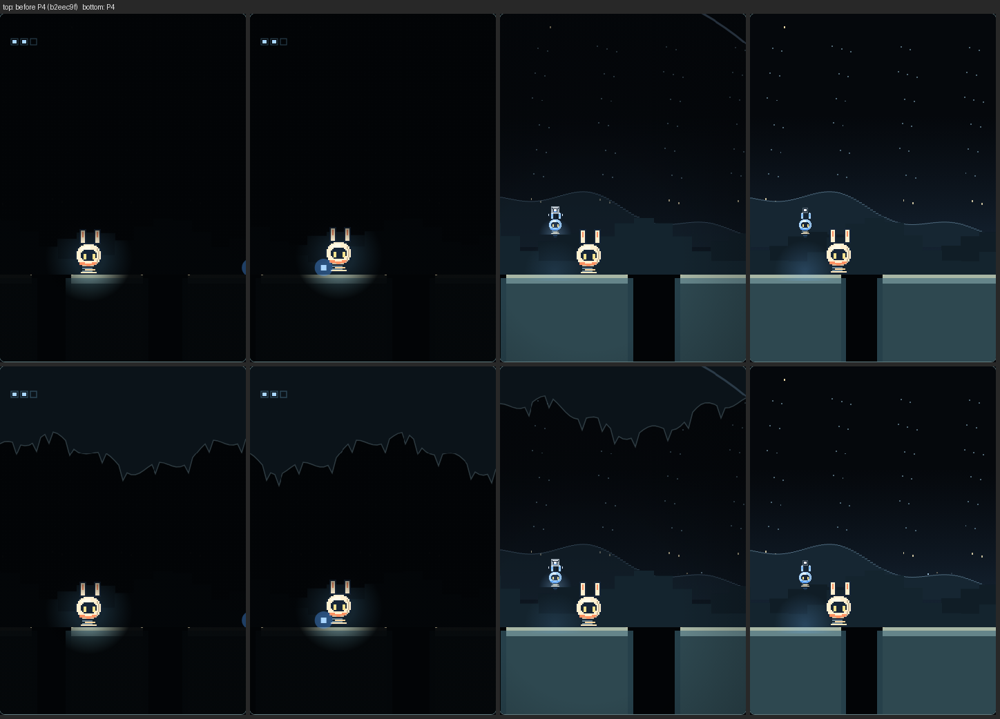
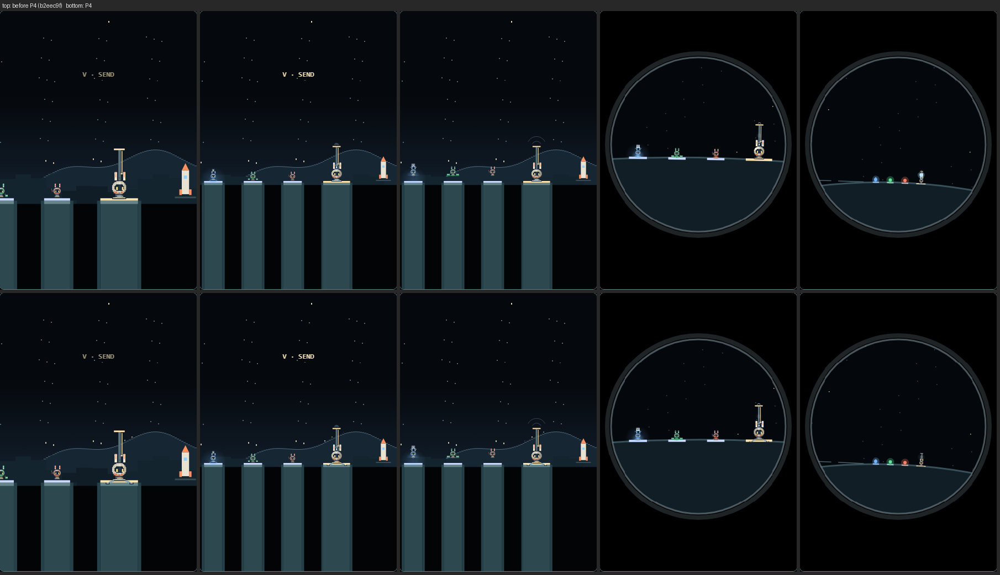

## First full play (2026-11-03): story for a first-time player

Findings from the first complete playthrough, and what changed. No new systems; FREE RUN untouched.

| # | Finding | Cause found | Change |
|---|---|---|---|
| ① | The dark start was the hardest part: holes hard to judge | the hero's glow is ~64px, a FAST hop lands up to 210px ahead; only sparse dots marked edges | a faint line along each platform top and lit cliff edges, brighter near the hero and on each touchdown; everything else stays dark until blue |
| ② | The switch read as a pickup, not "leave green here to make a bridge" | measured: switch → chasm 440px; when green is near the socket the view's right edge is ~14217 and the chasm starts at 14288, so it was never on screen | the chasm now starts 220px past the switch (only the ground after the switch is shorter); a cable runs from the socket to the bridge anchor, a pulse runs along it while green is over the socket, it lights when the switch holds |
| ③ | Why red goes back was unclear: green is off screen | nothing linked green to red's decision | green keeps calling from the switch (an arc each beat); at red's notice beat green's call comes in from the left edge, red's ear tips catch it, red answers, then flies; the comms window opens from that beat and shows green waiting |
| ④ | Separation, rescue and reunion barely changed the music; green inaudible on a phone | green's bass is 82–147Hz, below what phone speakers play | the bass line is doubled two octaves up as a short pluck (phone band +12dB, full-range level +7%); a far green's radio filter takes it away first; while green is away blue's tune thins to its downbeats |
| ⑤ | The moon, the leaving rocket and the friends staying weren't clear | no Earth, no lunar ground, nothing loaded | Earth over the far range, hidden by the rock ceiling until blue lifts it; craters on the near plain; in the ending the four lights leave the mast one per beat (D+13 to D+17) into the rocket's window, which keeps them as it lifts off |

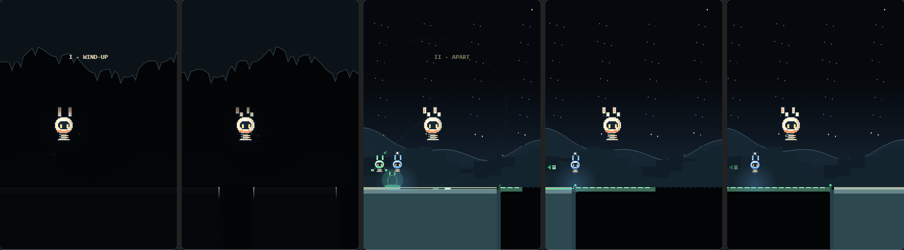
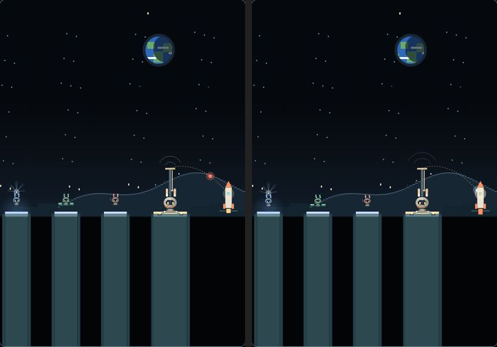

The real-audio test that failed on CI for both P4 commits was the test driver, not the game: a release and the next press at the same instant made the press wait a frame. Under load the old driver failed 1/6, the fixed one 9/9.

## Fitting green and red (2026-11-03)

Not a second collection like blue's three parts: each friend is met unfinished and the hero completes it on the spot, and the part it was given is the one it later works with. No detour, no new chapter; the last STORY feature before first-time playtests and release prep.

- **Met missing a part.** Green lies with bare hip sockets and a dotted outline where its foot pads go; red sits with a bare shoulder socket and the outline of its folded arm. Eyes dark, no music from them yet.
- **The part on the road, 300px before the friend**, glowing in its colour: green's magnetic leg unit (two pads on a bar under a horseshoe magnet whose field flickers), red's telescopic hook (three nested tubes and a curled hook). Drawn at 1.5× the friends' own parts so they read on a phone.
- **Pickup → fit → boot, on the beat.** A landing within 110px picks it up (`kit`, its own chime). That's wider than any hop, so it cannot be hopped over; landed past it anyway, it jumps after the hero. It rises over the hero's head and arcs ahead to the friend, clicking in on the next beat (`fit`: green's a magnetic clamp with sparks; red's a ratchet). Green's pads swing out with the same overshoot and dust as on the socket; red tries the hook once, up over its head towards the hero, snap, snap, home. Eyes flicker on half a beat later, and on the beat after the click the friend boots (`join`, two rings): its part joins the song on that beat.
- **Seen even at FAST.** The meeting uses the socket's pull-back (0.75): leaning ahead to show friend and part, then the view stops on the friend while it boots, the hero hopping on (friend ≥40px from the left, a full FAST hop's landing still on screen). Then green follows at its own pace, red dashes to the hero's side and walks along.
- **Never stuck.** The part cannot be missed. A fall while a friend boots (not reachable on this ground) has it ready at the checkpoint. A restart before the part has the friend waiting unfinished, one past it has the friend along.
- **Different from blue's:** blue's parts go into a tray and assemble with the dawn; these fly straight to their friend and are installed in view, and each is used later. Green's legs anchor the bridge's root; red's hook works the crane's span and lifts green home.
- Course: the meeting grounds of ② and ③ are 540px (were 420/380); the checkpoint is their first 80px.
- Review captures and clips: `node tests/browser/capture-p7.mjs`, `node tests/browser/record-p7.mjs` (phone viewport).

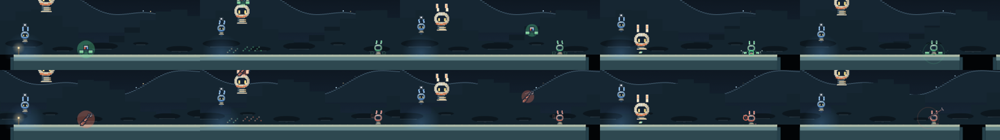

## Seeing the friends work (2026-11-03)

Playtest: the bridge was usually finished before the player saw there was none, and red went off screen to the crane, so neither friend's work read as theirs. Measured before the change: in calm play the chasm's near edge was on screen 1.3s before green arrived, and the far bank only 1.9s after the bridge was done.

- **The missing bridge, then green building it.** The chasm is 220px (was 300; still beyond a FAST hop with footing, 236px effective). Approaching the socket before the bridge exists, the view pulls back to 0.75 and leans ahead, holding socket, chasm and far bank together: about 2s of "no bridge" (folded pieces at the near edge, a dashed outline, a broken stub and a waiting light on the far bank) before green arrives. The hero stays at least 50px from the left and everything ahead is in view, so no landing is hidden. It lets go once the bridge is laid.
- **Four pieces on the beat.** Green's legs go down (0.08s), then the bridge is laid in four pieces, one per sixteenth note from the next sixteenth, each with a pluck up the G chord (`plank0`–`plank3`). Solid only as far as it is laid; the last piece meets the far bank without a seam. Three SLOW hops before the edge still always succeed. When red carries green off, two bright pins hold the bridge's root: it stays.
- **Red works the crane in view.** After waking red walks beside the hero; 300px before the crane it flies up to the boom (0.6s) and only then does the span move, its arm being the cable: it pays out as the span drops and hauls in as it rises, two beats down of four. Before red is on the boom the span hangs up out of reach. Falls at the crane keep red working; a restart there has red beside the hero again.
- **Reunion cue** now sounds when the reunion happens (its time depends on the player's speed up to that moment; predicting it drifted up to 52ms).
- **Blue's parts** are drawn as what they are: a lens, an emitter with rays, an antenna with a dish (also in the tray).
- **Before/after:** `node tests/browser/record-p6.mjs` (BEFORE_URL/BEFORE_ROOT for the old checkout).

## Green's socket (2026-11-03)

The switch rule changed from "the link breaks near the switch" to **green steps on its socket, plants its legs and becomes the bridge's root**. Chosen after simulating alternatives on the real course (4,096 input patterns from the field's checkpoint, plus arrivals from the valley):

| Variant | First try, calm player | First try, rushing | Decided by the last 3 hops? | Stuck risk |
|---|---|---|---|---|
| Old (link breaks near the switch) | 0% | 0–4% | no | needed the assist |
| Socket, green still stops when the link breaks | — | — | no (42% even with 3 SLOW) | high: two FAST hops lose green for good |
| **Socket, green never stops (adopted)** | ~80% | ~50% | **yes: 3 SLOW → 100%, none → 0%** | none |

- **Rule:** green chases at 160px/s (between SLOW 105 and FAST 270) and never stops; out of range only its signal bars, line and music fade. The socket is 100px before the chasm. The instant green reaches it (closed form: the later of green's own run and the hero's, not a frame end) it plants its legs (0.18s), and the bridge runs out from under it at 520px/s. The bridge is solid only as far as it has grown (`bridgeFront`), so rushing ahead means landing where it is not yet.
- **Seen, not told:** as green comes within 80px the socket glows, the rail to the chasm shivers and a soft ping plays. Green drops onto the plate, its pads swing out, clamps rise to them and the rail lights, then the deck runs across with its struts and a bright tip. If the hero falls into the chasm first, the view slides back to the socket so the player sees green arrive and the bridge run out, too late.
- **Kept:** once built the bridge stays (a fall never undoes green's work). Respawn puts green beside the hero. Red still finds green holding the bridge and fetches it; the music's distance fade and reunion are unchanged.
- **Relays** boost a green out of range (it dashes at 320px/s with a streak), so a player who rushed the valley meets green again before the socket. No warp.
- **Removed:** stranding ('lost'), the snap window, its widening per fall, green lingering over the socket, the auto-settle after four falls, the strand cue. The fall hint skips the chasm (the late bridge is the hint there).
- **Checked:** Node tests for calm, rushed, far-behind (relay), falls before and after the bridge, frame sizes 1/30–1/144s, 0.78s and random; full browser playthrough; real-audio rescue and reunion. Clips: `node tests/browser/record-green.mjs` (green-calm, green-rush).

## Proposals round (2026-11-03)

Chosen with the owner: shorter ①, checkpoint lights, friends reacting to falls, a beat mark; fall hints and vibration as optional. Not adopted this round: taller canvas, chapter bar, final tick; the "reply from Earth" is out (the ending stays the four lights receding).

- **① shorter and taught by the ground.** Hand-placed in three lessons, a blue part after each: narrow gaps (SLOW alone can do it: find the rhythm), wide gaps (SLOW cannot cross: FAST), short landings after wide gaps (FAST alone or SLOW alone falls: SLOW is the control). To the third part: 5055 → 3982px; without falls 20–28s instead of 20–39s. Blue's awakening unchanged.
- **Blue's bell steps back** when green or red play (×0.7; in the ending from green's entry, D+1 stays full). Phone band (300Hz high-pass): bell to bass was 24dB apart before P5, now 7dB (bass pluck .12).
- **Checkpoints:** a small lantern where a fall brings the hero back; it catches with one soft ring as the hero passes and stays lit; drawn over the dark. No sound.
- **Friends see a fall:** ear tips flash for 0.3s, then the eyes turn towards where the hero went down and drop, until the respawn. Drawn over the shared face; nothing waits.
- **Beat mark:** a tiny antenna in the control's corner whose tip lights for 0.1s on each beat (the clock the hops run on, not a cue to press). With `prefers-reduced-motion` it stays still.
- **Fall hint:** only after a second fall from the same checkpoint, the edges of that hole glow softly until the hero is past it. Never a landing marker.
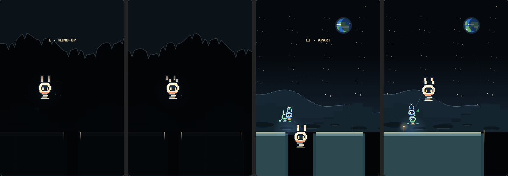

- **Vibration:** only where `navigator.vibrate` exists (the button is hidden elsewhere); blue built, switch, pickup, reunion, dock (one pulse, then the silent beat). Never on landings. A BUZZ ON/OFF button, remembered.

## Real Web Audio verification

`tests/browser/story-audio.spec.mjs` runs a real `AudioContext` in Chromium (headless, real time, no clock mocking). With `STORY_AUDIO=required` (set in CI, and by `npm run test:story-audio`) a browser without running audio **fails** instead of skipping.

Where it actually ran with real audio:

| Environment | Tests | Notes |
|---|---|---|
| CI, ubuntu-latest, Playwright Chromium headless (run 41442506580, commit 303c8e9) | 5/5 executed, none skipped | 44.1kHz, `baseLatency` 0.01, `outputLatency` 0.032, `getOutputTimestamp` available (from the uploaded `story-audio/*.json`) |
| Local Windows 11, Playwright Chromium headless (P3) | 6/6 executed with `STORY_AUDIO=required` | 48kHz, `outputLatency` 0.04 |
| Android phone / Bluetooth | 0 | not done; P5 |

Checks:

| Check | Result |
|---|---|
| JS exceptions / console errors during play, pause, resume, mute, ending | none |
| Every touchdown has a tick note scheduled on exactly that beat; every note at `s + offset` (spread < 1µs) | pass |
| Bell enters only after assembly; bass with green; percussion at the base; ending: no tick, bell D+1, bass D+5, perc D+9 (P4 gates) | pass |
| Pickup ×2 and assembly cues predicted and scheduled at their event time; late cues | 0 late |
| Fall beat has no tick; respawn beat ticks; fall cue predicted | pass |
| Red leaves: perc → < 0.1; after pickup bass/perc return faint and rise (0.27 → 0.71 → 0.90, 0.5 → 12kHz); notice/rescue/pickup/reunion cues predicted, 0 late | pass |
| D+1 carries two bell notes (arpeggio + low G hand-off) | pass |
| Pause: story time frozen, no new notes for 1.5s; resume continues; mute: master → 0 while time and scheduling continue | pass |
| Measured latency (headless Chromium): `baseLatency` 0.01s, `outputLatency` 0.04s, context clock ahead of heard time ≈ 48ms; `getOutputTimestamp` available | recorded |
| Offline render of all parts + rumble: NaN 0, peak 0.29 | pass |

Not measurable here: real speaker/Bluetooth latency and touch latency on Android.

## Tests

- `tests/story.test.mjs`: green's and red's parts (met missing, picked up and never hopped over at any rhythm, clicked in one beat later and booted on the next, before the hero is past the friend; a fall while booting), exact beat, clock rebasing/pause/jitter/latency mapping, full-course solvability and length, frame-rate independence, green's socket (SLOW brings green and the bridge forms; FAST alone falls and the bridge forms behind and stays; three SLOW hops before the edge always work, none never; arrival and bridge independent of frame size; a far green is boosted by a relay), green never stops in the valley, respawn keeps progress, story event order (incl. notice → rescue → pickup → reunion), crane beats, music hand-off, finite notes, noisy play never stuck, a fall after red leaves the crane, falls at six rescue/base moments.
- `tests/browser/story.spec.mjs` (3): FREE RUN link; start on the beat and pause without losing phase; a full browser playthrough with real key events to the end card, checking every story beat in order, the comms window, no touchdown after the dock, and the four lights.
- `tests/browser/story-p2.spec.mjs` (2): blue reveal and green link/relay/switch scenes.
- `tests/browser/story-p3.spec.mjs` (2): red's rescue scenes (red waits exactly one beat); the dock beat to black: friends hold still on D, blue lands on D+1 with the hero's first blink, green D+5, red D+9, the light on/off on the three beats after, four lights > 14 CSS px apart on a 390px-wide screen.
- `tests/browser/story-crew.spec.mjs` (1): crew silhouettes in both forms, measured from pixels.
- `tests/browser/story-audio.spec.mjs` (6): real Web Audio checks above.
- All 72 existing Node tests and 38 existing browser tests still pass.

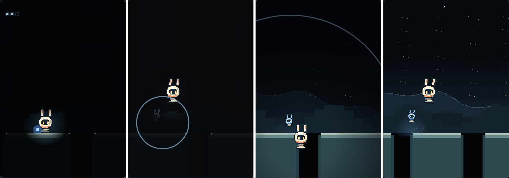
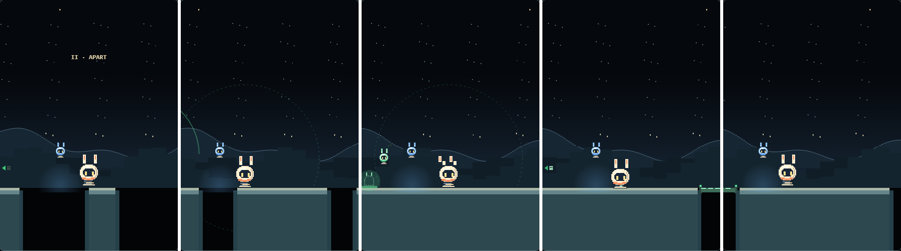
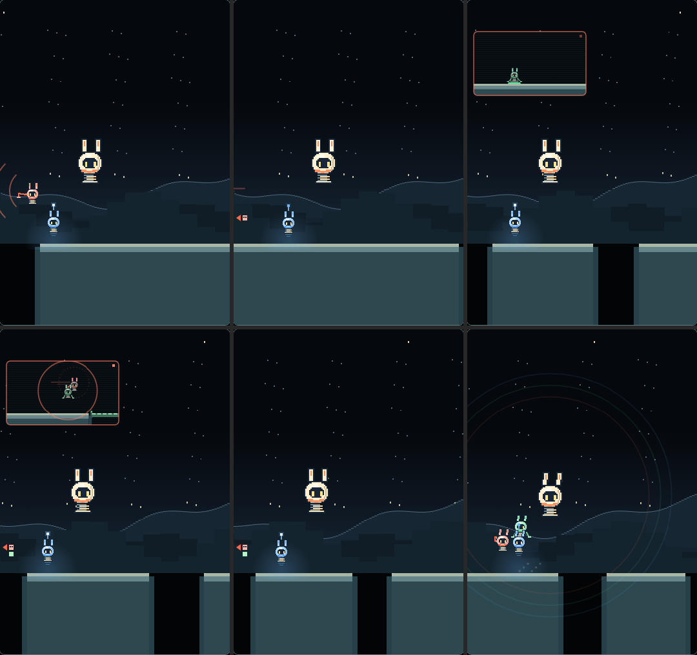
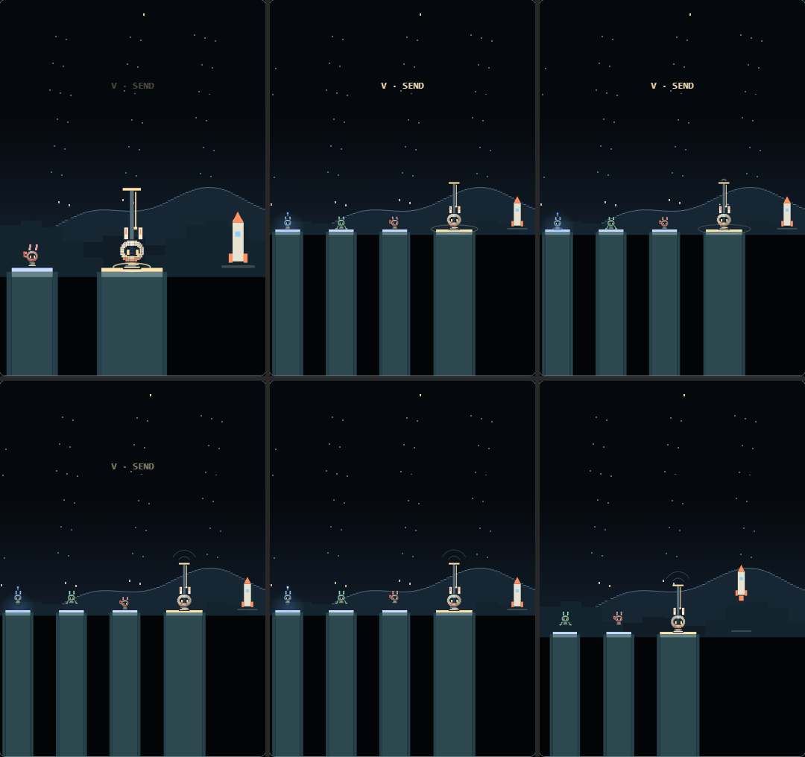
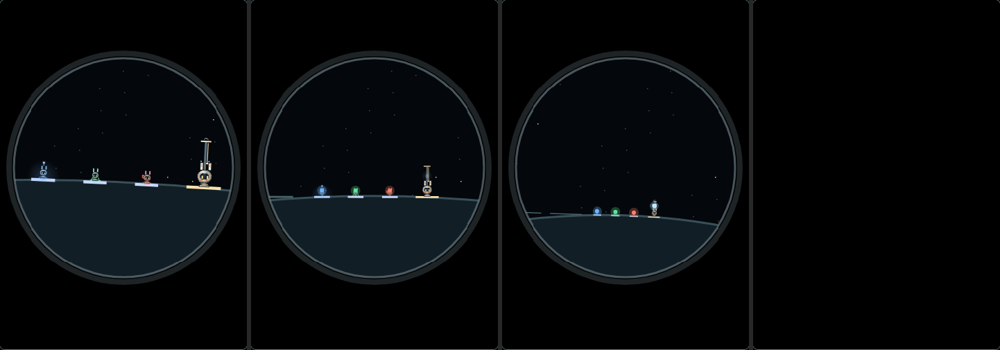

## Release entry and language (2026-11-03, PR #16 review)

- **Entry.** `index.html` decides before any game code loads: the bare address, or one with only `?lang=`, goes to `story.html` (carrying a valid `lang`). Any other parameter (`mode`, `date`, `seed`, `v`, `marker`, …) stays on FREE RUN, so every old shared or replay link opens exactly as before. All paths are relative (`story.html`, `index.html?mode=free`), so the same files work inside an itch.io ZIP folder and on Cloudflare.
- **Language.** A valid `?lang=ja|en`, then the player's saved choice, then English. The browser language is not consulted. Switching saves the choice; STORY also rewrites its own `?lang=` (a stale one would win on reload). Links between the pages always carry `lang=`, so the language survives page moves even where storage is blocked. FREE RUN keeps its address the exact replay link (no `lang`; the share link equals the address) and keeps the language in its history entry (`history.state`), so a reload keeps it without storage too.
- **Known limit.** Without storage, a *new* tab or a typed address starts in English (nothing is remembered outside the tab).
- **Long stalls.** A frame later than 0.5s pauses the story on the last instant it simulated and drew; nothing is simulated unseen. RESUME is always at SLOW. Cue predictions cancelled by PAUSE are forgotten and scheduled again; a launch paused mid-way resumes its rumble from where it was.
- **Lesson one** is cleared by SLOW alone (each touchdown at least 13px inside its footing); lessons two and three still need FAST, and both speeds.

## itch.io build

`npm run build:itch` writes `output/itch/rapippo.zip`: every file under `public/` except `dev/` (the sound bench) and dotfiles, with `index.html` at the root (22 files, about 80 KiB, no build step). `tests/browser/itch-zip.spec.mjs` reads that ZIP back and plays it from a sub-folder of another origin inside an embed iframe: title, play, the touch PAUSE, FREE RUN and back, with every request answered from the ZIP.

On touch screens PAUSE is a 44px button in the header while playing (hidden on the title and the end card); it releases a FAST held by another finger. From the dock on, the FAST/SLOW control is disabled and a held FAST is released.

## Open items (next)

- From here (2026-11-03) no new STORY features as a rule: first-time playtests and release prep.

- Feel: crane look, the comms window's art, reunion polish, friends overlapping while following.
- P4: real composition and mix, light/space art, moon curvature in the rocket view, chapter pacing (① runs ~70s at a slow pace; target 50s).
- Menu: DAILY inside FREE RUN; STORY as the jam entry point for itch.io.
- P5: Android portrait, background/return on device, novice test, disclosure text, itch.io build.
