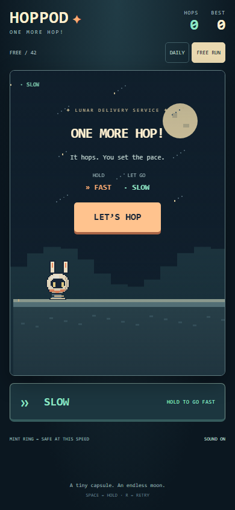
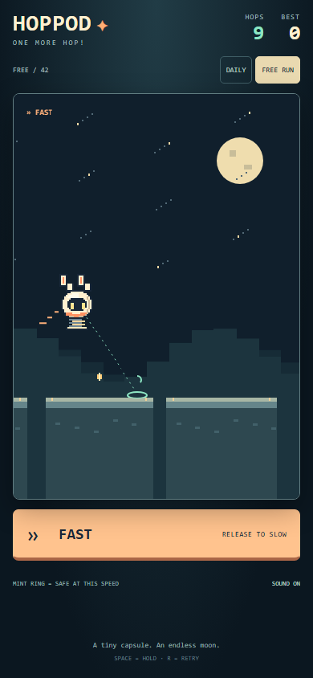
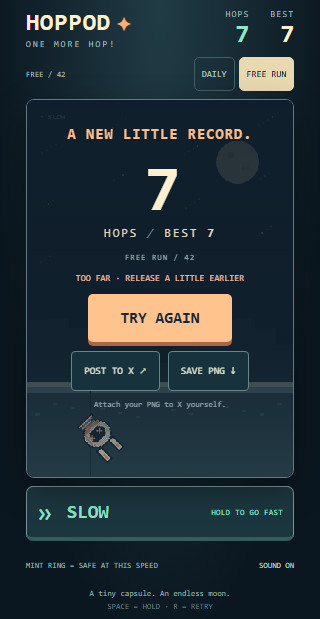
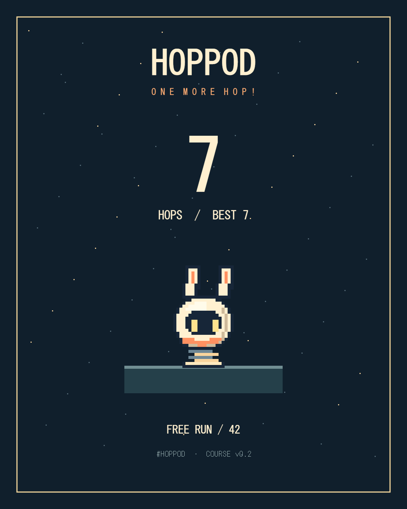

# HOPPOD v0.2 — playable polish / 2026-11-01 JST

## Scope and provenance

Based on open Draft PR #1, `feat/endless-prototype` at `01d190e3a1710370d5b3aceb16133e0996ac7b38`. The initial local folder was empty; cloned from `madowaku/hoppod`. `main` was `f50befbd326cbc62c1b0d270e20f85fc5b94c6c9`. Work branch: `codex/v02-playable-polish`; PR base is `feat/endless-prototype`, so merge #1 first or deliberately retarget after integration. No main merge or production deploy.

Goal: one charming capsule, readable speed decisions, satisfying landings and quick retries. Canvas 2D, vanilla JS, 0.78s automatic jumps, 105px/s SLOW and 270px/s FAST are unchanged. HOPS counts successful landings only.

## v0.1 browser findings

Started v0.1 locally in Chrome at 390×844 with FREE seed 42, used START, waited, pressed/released Space, reached the result and retried. The constant-SLOW run died with 2 HOPS, so it did not teach three safe introductory hops. The result's `SIGNAL LOST` did not explain a speed error. The provisional rectangular pod did not animate its spring or antenna state. Initial browser console also had a missing favicon. Baseline screenshots are in `output/playwright/v01-*.png` locally (not a human playtest).

## Design choices and resulting behavior

- Keep the small native Canvas application. An engine migration or external generated sprite pipeline would add work without improving this mechanic. All shipped art is original pixel drawing in `pod.mjs`; all cues are original Web Audio oscillators in `audio.mjs`. No borrowed sprites, recordings, fonts or other works' assets. AI-assisted code/art implementation; attribution and rights acceptance by the owner remains a release check.
- The pod has an approximately 32×36px animation envelope (20×18px body). Rounded cream casing, orange trim, black visor, two yellow eyes, antenna bend, spring compression/extension, idle bob/blink and falling rotation/X eyes. The same drawing renders at integer scale in gameplay and the score PNG. Jump arc and spring read the simulation phase. Landing dust and FAST streaks are bounded, and reduced-motion mode suppresses them.
- A 735px initial runway guarantees three successful hops at any combination of the two speeds, including full FAST. Tutorial cues disappear after three landings. SLOW-only can linger for seven hops, which leaves room to understand the ring. Thereafter, platform centers are 150–180px apart, widths gradually tighten toward roughly 106px, and wide merged runways recur every ten reference hops. The random widths/distances and rest runways break up the rhythm; the difficulty plateaus rather than becoming impossible.
- A single supported platform can have several safe landing positions. Non-intro edge/middle positions must have at least a 20px next-hop reachable interval on the current/next platform. The tests separately use a geometry-only controller with timing errors, not just the generator's reference route. This demonstrates physical recoverability and margin, not proof that a human can read or enjoy every pattern.
- The landing ring and countdown read the same `phase`, `predictLanding` and inset-aware `isSafe` as collision. Edge ticks show the 8px support margin. Mint is safe if the current speed continues; coral suggests HOLD/RELEASE. Advice is a cue, not an automatic solver or guarantee after a late input change.
- Results report TOO SHORT / TOO FAR relative to the nearest supported edge and offer immediate retry. HOPS/BEST are the only persistent counters. Optional beacon pickups remain small world accents and internal counts; their counter was removed from the HUD.
- The full original elapsed frame time advances physics at ordinary frame rates. A stall over 250ms pauses and clears input instead of silently slowing time with the old 50ms cap. Blur, pagehide and hidden-document transitions require explicit RESUME at SLOW.
- `pointercancel`, lost capture, release outside the control, keyboard retry and mode changes clear their input state. Keyboard Space still activates focused START/RESUME controls. Starting/resuming releases that button's focus so Space can control the game immediately.
- Sound unlocks only on a user gesture. FAST/SLOW and rhythmic land/fall cues are short and optional (SOUND ON/OFF); silent play and blocked storage remain supported.

## Course and sharing identity

Terrain changed deliberately from v0.1; seed geometry and highscores are not comparable across those versions. Canonical URLs carry `v=2` and local best keys use `hoppod.best.v2.*`. v0.1 URLs without a version normalize to v0.2 in this unpublished candidate; no old runtime is bundled. Pin the terrain algorithm for any published v0.2 links, or introduce a future versioned runtime before changing published course semantics. The `v` parameter is a current-course label, not multi-version routing.

DAILY is seeded from a validated real calendar date in Asia/Tokyo. Shared past dates remain replayable; choosing DAILY again selects today. An already-open run remains on its canonical date across midnight. FREE RUN without a seed now generates one (v0.1 converted missing seed to zero); numeric zero is still a valid shared seed. Invalid, negative and oversized seeds normalize. URL state is normalized on load, course switch and browser history changes.

BEST persists per daily date and across FREE RUN seeds, matching the prototype's scope. Storage failure uses an in-memory best for the current course session. No online leaderboard or score verification is implied.

POST TO X passes HOPS, BEST and the exact normalized replay URL to the composer. Nothing is automatically posted or attached. SAVE PNG downloads an original 1080×1350 score card with mascot, HOPS/BEST, date or seed, and course version. Production links will use the deployed origin; a locally generated post contains localhost, so do not share that local URL as a public game.

## Automated verification

Windows local run, Node 24.14.0, Playwright 1.64.1 / bundled Chromium. CI uses Node 22 on Ubuntu. Commands: `npm test`, `npm run check`, `npm run test:browser`.

15 Node tests pass:

- Existing deterministic geometry/reference route, 100 seeds × 100 successful hops, successful-landing scoring and invalid delta checks retained; reference plans now store FAST seconds per hop rather than booleans.
- 128 seeds × all 8 whole-hop input combinations in the first 3 hops.
- 128 seeds × 300 hops using only visible geometry, with -60/0/+60ms switching offsets (38,400 safe landings).
- 128 seeds extended through 50,000px, checking non-intro platform edge/middle recoverability with a 20px interval.
- 32 seeds × 1000 aggressive forward hops (32,000 landings), checking bounded platforms, reference plan and position map. Trimming is based on world position, independent of score/reference-hop drift.
- Real 30/60/120/144Hz frame grids with input switches at the same elapsed times, plus reference-route subdivision checks. Same score/death/position; predictions agree at collision boundaries. This is synthetic scheduling, not physical high-refresh device testing.
- Exact boundary/double-score regression, failure advice, JST midnight/calendar validation, shared historical day, absent/zero/invalid FREE seeds and X URL round trips.

10 browser tests pass:

- A real-time browser run: start → at least 3 landings → fall → retry at SLOW/0 HOPS.
- A separate controlled-clock run with actual keyboard events: 16 successful hops across islands, FAST and SLOW screenshots. This follows a reference timing schedule and is not human play.
- Pointer hold, outside release, cancellation, blur, pagehide, synthetic visibility, reset during held keyboard, mode changes and keyboard START activation.
- Storage blocked, reduced motion and long frame stall/resume.
- Actual PNG download, decoded dimensions 1080×1350, filename, persisted best and intercepted X composer arguments. X is not contacted or posted to by the test.
- 320×568, 390×844, 1440×900 and 844×390 viewport screenshots with no horizontal overflow or result-control clipping inside the game overlay. Landscape uses vertical page scrolling. Mobile viewport emulation is not an Android test.

Screenshots and score PNG were visually inspected. The narrow result, FAST playfield and exported PNG have legible scores, visible controls and the original capsule. Browser tests listen for uncaught page errors; the initial favicon failure is fixed. Local screenshots/traces/JSON are reproducible under `output/playwright/`, and CI uploads evidence on every browser job.

## Screenshots

## Owner playtest / remaining release checks

1. Run the local command in README and play without reading the code. Do the first three hops teach that you control speed rather than jumping? Is the mint/coral ring clear, especially at the platform edge?
2. Try DAILY and at least three FREE RUNs. Judge whether the first gap, tightening islands and wide rest runways feel fair. Does a failure make the next try's timing understandable? Are 5–10 retries inviting rather than frustrating? These are unverified human judgments.
3. Check whether the mascot reads as a spring capsule, whether the antenna movement is lively at phone size, and whether the landing rhythm/FAST cues sound pleasant. Audio code executes in automated browsers; physical speaker output and subjective sound balance are unverified.
4. On actual Android: touch/hold/release, cancellation, rotation, background/foreground, audio unlocking/mute, PNG download, and the X in-app browser. No Android hardware was available for this task.
5. On an approved hosted preview: public replay URLs, JST day transition, X composer and manually attaching the saved PNG. No real X account flow, external image attachment, itch embedding, production Cloudflare deployment, or social crawler/OGP preview was tested. Decide absolute production OGP URLs/art before public release.

The project is locally playable and submitted for review, not declared human-accepted or release-approved.

## Documentation differences resolved

- README's final sentence said code would arrive on a future prototype branch although the checked-out PR already contained the game. Replaced with runnable commands and current v0.2 status, following existing code and this request.
- `docs/PROTOTYPE.md` describes temporary Canvas art, a beacon HUD and v0.1 terrain. Preserved as versioned history with a prominent v0.2 pointer; current implementation and deliberate changes are specified here. No adopted mechanic was silently changed to match stale text.
- The prototype used `plan` booleans and a 50ms render-time cap; code/tests now use reference FAST durations and stall-pausing as documented above. These are implementation changes, not changes to the prescribed period/speeds or score rules.
