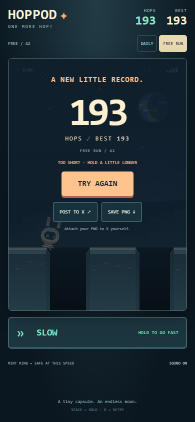
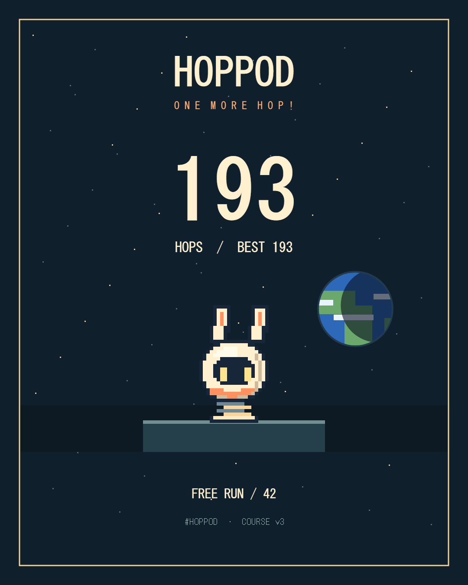
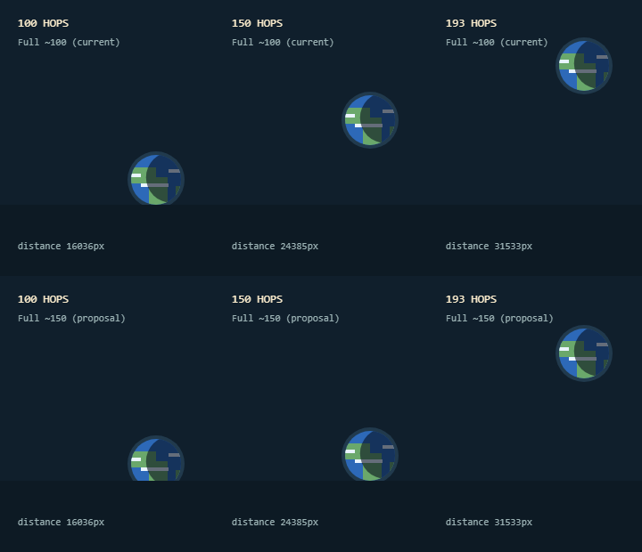

# HOPPOD v0.3 独立レビュー / 2026-11-01 JST

対象: Draft [#3](https://github.com/madowaku/hoppod/pull/3) `9d95ea4` と [#4](https://github.com/madowaku/hoppod/pull/4) `6f208ad`。GitHubのheadとローカルを照合し、クリーンな #4 から `codex/v03-independent-review` を作成した。#3/#4のCIも成功していた。ユーザーが報告した「人間試遊193 HOPS、面白い・癖になる」は採用済みの人間の評価として扱い、今回の自動操作と混同しない。

## 公開判定

**#3/#4をそのまま公開するのは保留。P1の音声停止不具合を修正してから取り込む。** 本レビューの修正後は技術面で限定公開候補になるが、公開前のAndroid・実スピーカー・公開URLでのX手動共有確認は残る。地球の全景を150 HOPSに遅らせる変更は推奨しない。mainへのマージ、本番・プレビューへの外部デプロイは実施していない。

## 指摘（重大度順）

### P1 — ミュート・リトライ後にも100 HOPSの和音が残る【修正済み】

場所: `public/src/audio.mjs` の `toggle` / `play`、`public/src/app.mjs` の `reset` / `pause` / `loadCourse`。元のコードはミュート時にフラグを反転するだけで、既に鳴っている音と、+320ms後などに予約済みの音を止めない。リトライにも停止処理がなく、前のランの約1.5秒の和音が新しい0 HOPSに持ち越される。`/dev/sfx.html` のSTOPもタイマーだけを止めていた。

追加したNodeテストは修正前に2件失敗した（ミュート後のstop時刻が依然10.25秒、run停止APIはundefined）。修正では通常音・記念音を追跡し、予約音をキャンセル、再生音は8msでフェードし10msで停止する。ミュート、再挑戦、コース変更、非表示・一時停止、落下の各ライフサイクルで停止する。通常音も `ended` で切断し、音声ノードを残さない。アクセントの12声上限と一つのコンプレッサー再利用は維持する。

検証: 実ブラウザのAudioContextで100 HOPSの音を鳴らし、UIのミュート・R・Escape・DAILY切替後に、開始前の予約音も含めすべての `ended` を確認。実際のOfflineAudioContextで、100→101→102の着地を0.78秒間隔でレンダーし、途中ミュート後130ms以降は完全に0。通常着地の周波数・ゲイン・接続経路を維持し、classicとの通常音サンプルも一致した。

### P2 — sessionStorageが禁止されると `?sfx=classic` が無視される【修正済み】

場所: `public/src/app.mjs` の `accentsEnabled`。明示されたclassic指定より先にsessionStorage書込で例外になり、catchが常にlayeredを返していた。ブラウザのストレージ制限下でA/Bの比較条件が変わる。URL値を先に読み、保存できなくても明示指定を優先するよう修正。URL正規化・再挑戦後もclassicが有効なことを追加テストで確認する。

### P2 — 高記録の結果画面では地球が暗くなり、到達感が弱い【見た目の改善候補・未変更】

場所: `public/style.css` の `.overlay[data-screen=result]`。193 HOPSの実ブラウザ結果画面では、背景を約85–91%覆うオーバーレイで地球が暗くなる。保存PNGはこのオーバーレイを使わず、193 HOPSの地球を明瞭に表示できる。スコア、ボタン、PNG保存の不具合ではないため公開阻害にはしないが、SNSで結果画面自体を撮る目的なら、装飾用の地球をオーバーレイの前面・文字と重ならない場所に置く方向がよい。全体を明るくしてスコアのコントラストを落とす変更は避けたい。採用演出は勝手に変更せず、比較資料として残した。




## 地形の結論

**v0.2の見えない落とし穴は、調べた範囲で解消している。新しいP0/P1の地形問題は検出しなかった。**

- `addPlatform` が重なり・接触・16px未満の穴を一つに統合する。16pxちょうどは穴として残り、両側の8pxの段差も含めて画面で見える。`footing` が明るい平面と判定の共通区間で、背景は足場の下に描かれない。
- 既存の512 seed×30,000pxの調査、端点の±0.01px、最初の40pxの穴、リングと判定の一致、30/60/120/144Hz・切替誤差・回復可能性テストを再実行した。
- 独立の追加検証: 256 seedで137pxずつ追加生成する場合と一括生成の配置が一致。16 seed×10,000ホップ（計160,000着地）は参照ルートを見ず、見える足場の近い／遠い位置を狙って進み、判定とスコア、足場・ビーコン・参照マップの上限を毎ホップ確認した。
- 実ブラウザで16pxの穴と連結した平面をテスト用レスポンス注入で作り、Canvasピクセルを確認。端点はCanvasの丸めで1px未満の量子化があるが、広い「地面に見える死亡区間」はない。数学上の境界はNodeテストで別に検証する。
- seed 42を実際のキーボードイベントと制御時計で193 HOPSまで進め、その後は到達可能範囲の穴を選ぶ入力で本当に落下させた。193の結果・BEST・PNG・X URL・再読込を確認した。人間の193 HOPSを再現・代替した試遊ではなく、合成入力のブラウザ検証である。

## 音の完成度と限界

通常着地は従来どおり0.78秒周期・5音循環。10/50/100の分岐は上位tierが優先され、50に10を、100に50と10を重ねる処理はない。193ホップのブラウザ実行では10,20,…,190が各一回ずつ呼ばれ、コンプレッサーは一つだった。100の和音が次の二つの着地に重なるのは意図した構成。

2秒・48kHz・monoの実Web Audioレンダー（100/101/102を0/.78/1.56秒で再生）:

| 指標 | Layered | Classic |
|---|---:|---:|
| 最大絶対振幅 | 約0.09820 | 約0.06966 |
| 2秒全体のRMS | 約0.01397 | 約0.00581 |
| 通常着地サンプルの差 | 0 | 0 |

デジタルクリップ上限1.0に対して十分な余裕があり、このレンダーにクリッピングはない。Layeredはピークで約3dB上がり、長い和音の分だけ2秒全体のエネルギーも増える。これは音量の主観評価を済ませた証拠ではない。端末負荷は生成声数と解放経路を検証したが、AndroidのCPU・電池・実スピーカー歪みは未測定。ブラウザの合成時計とAudioContextの実時計は別なので、193ホップの短縮テストの重なりを実プレイの負荷測定として扱わない。

[Layered試聴用WAV](review-v03/hundred-layered.wav) / [Classic試聴用WAV](review-v03/hundred-classic.wav)。同じ出力音量のまま比較する。ブラウザで合成した原音であり、マイク録音ではない。

## 地球：100と150の判断材料

リングのミント・警告色は地球より後に描画される。60/100/150/200相当の背景でもミント色のピクセルが保持されることを確認し、100/150/193の実進行画面を目視した。背景は足場や穴を埋めず、リングの判定色を変更しない。

seed 42の参照ルートにおけるゲームCanvas上の地球中心Y（小さいほど高い。距離演出なので、異なる操作ならHOPS数との対応も変わる）:

| HOPS | 距離px | 現行 FULL=16,500 | 仮案 FULL=24,750 |
|---:|---:|---:|---:|
| 100 | 16,036 | 260 | 269 |
| 150 | 24,385 | 176 | 260 |
| 193 | 31,533 | 100 | 115 |

現行は100以降も約160px上昇し、地球・雲の漂いもある。約200以降は高さが飽和する仕様。150へ遅らせてもease-outにより100時点では既に大半が見え、150まで低い位置に留まる一方、150→200の上昇が急になる。**193 HOPSの一例だけで全景を遅らせる必要はない。現行維持を推奨し、複数人の分布で「100が容易すぎる」と分かってから検討する。**



比較図は高低を見やすくするため水平線と上限位置を固定した描画用フィクスチャで、ゲーム画面全体ではない。上表は実ゲームの座標。閾値・ゲームルール・v3地形はこの修正PRで変更していない。

## 公開準備

- DAILYの実日付/JST・URL版・翌日再訪の再現性を追加確認。v3が正規化され、同じ日付/seedの地形が一致する。
- v2のBEST=999を入れてもv3のBESTに混入せず、193の結果で `hoppod.best.v3.free` に193が保存され、再読込で復元された。Xのcomposer引数に193・BEST・正確な `v=3` のURLが入る。自動投稿や添付はしない。
- PNGは実際にダウンロードし、193 HOPSと地球を目視した。既存の320×568/390×844/1440×900/844×390に加え、高記録結果も320/390pxで撮影した。
- `.assetsignore` の `dev/` は[Cloudflare公式のgitignore形式](https://developers.cloudflare.com/workers/static-assets/binding/#ignoring-assets)に合う。Wrangler 4.156.0を開発依存に固定し、既存configで `deploy --dry-run` 成功（アップロードなし）。さらに実Wranglerローカルサーバーで `/`, `/src/app.mjs`, `/src/audio.mjs`, `/src/earth.mjs` が200、`/dev/sfx.html`, `/dev/sfx`, `/.assetsignore` が404。Pythonの編集用サーバーでは比較ページが200となることも対比した。CIもこの境界をチェックする。
- **ローカルランタイムの制約:** 固定したworkerdが対応する最新日は2026-10-30で、production configの2026-10-31をそのまま使うとローカル起動に失敗した。`preview:assets` はローカル検証に限り10/30をCLIで指定する。production configは変更せず、dry-runは本来の10/31のまま。10/31の本番ランタイム動作や実際のアップロードを検証済みとは報告しない。

## 検証コマンドと資料

```powershell
npm ci
npm test
npm run check
npx playwright install chromium
npm run test:browser
npm run check:assets
```

Node: **37件成功**。ブラウザ: **21件成功・skipなし**（最終の単独実行1.7分）。既存ブラウザ14件に独立レビュー7件を追加。構文確認と本来のconfigでのasset dry-runも成功。テスト用フックはPlaywrightがレスポンスにのみ追加し、配布コードにデバッグAPIを置いていない。`output/review/` に画像・音声・測定JSON、`output/playwright/` に通常の結果JSONと失敗時トレース。テストは同じ証跡フォルダを使うので、同時に複数のPlaywrightコマンドを走らせない（レビュー途中で一度競合し、以後は単独再実行した）。

## スタックの取り込み手順（実行はしていない）

1. #1 `feat/endless-prototype` → `main`。
2. #2 `codex/v02-playable-polish` のbaseを最新mainへ変更し、差分とCIを確認して取り込む。
3. #3 `claude/v03-fair-ground` も同様にbaseをmainへ変更・確認して取り込む。
4. #4 `claude/v03-earthrise` を同様に取り込む。
5. 本修正PR（baseは #4 の `claude/v03-earthrise`）をmainへ変更し、音声停止修正とレビュー追加分だけが残ることを確認する。各段階で履歴の保持方法により不要なコミットが差分に現れた場合は統合ブランチで確認し、無検証のforce-pushはしない。
6. 統合後の最終候補で37 Node / 21 browserとasset dry-runを再実行し、Android・音声・公開URLの共有・公開OGP/権利表記を確認してから、ユーザーが公開可否を判断する。

## 文書との差分

- `docs/V03_FAIR_GROUND.md` A7の「mutedならsilent」は新規発音の抑止しか検証しておらず、再生途中には成立しなかった。実コードを再現して修正し、本資料の停止テストで補った。
- `docs/CODEX_HANDOFF_V03.md` / `docs/V03_FAIR_GROUND.md` のasset除外は未確認という記述は当時の記録として保持し、今回のWranglerローカル/dry-runの証拠と日付制約をここに追加した。実デプロイは未確認のまま。
- 両v0.3文書が指す `output/repro/*.mjs` はGit管理外の補助スクリプトで、新しいcloneには含まれない。今回の独立レビュー画像と音声はコミットする `tests/browser/review.spec.mjs` で再生成できる。
- `docs/V03_EARTHRISE.md` の採用済み100/200の閾値に従った。150案は比較のみで未採用。ユーザーの193 HOPSは人間評価として保持し、自動テストで上書きしていない。
