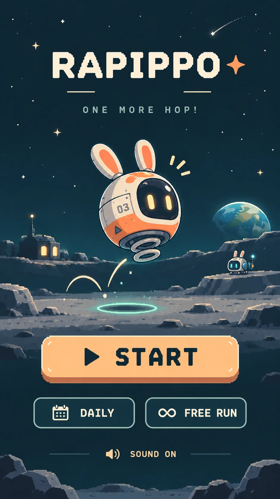
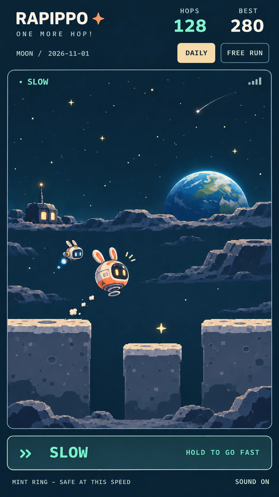
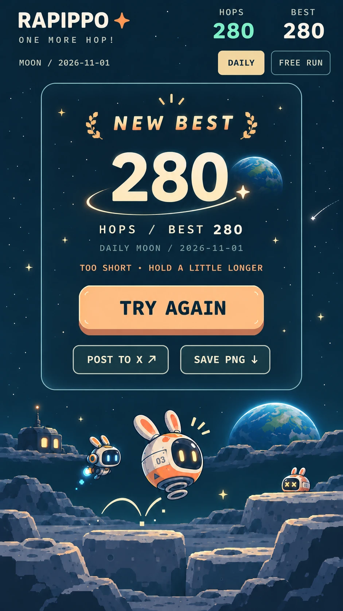

# RAPIPPO art and UX direction

Status: agreed direction (owner, 2026-11-01). **Docs only, no visual change.** Visual work comes after #12 has been checked and an integration decision has been made, in separate, comparable stages.

## North star

> Make the feeling of **travelling across the Moon by hopping** richer, not the screen busier.

Every visual or audio addition is judged by one question: does it deepen the journey (sky, Earth, terrain, companions, discoveries) without taking the player's eyes off the rhythm?

## Mood references

These images set **mood and art direction only**. They are not a spec to reproduce one-to-one. They are drawn at far higher detail than the 360 × 510 game canvas.

| Start | Play | Result |
|---|---|---|
|  |  |  |

What we take from them:
- deep teal night sky
- warm orange/cream hero against a cool blue companion
- Earth low on the horizon
- layered lunar ridges
- a small lit outpost in the distance
- a result screen where the run's companions and Earth share the frame

What we do **not** take from them:
- the landing ring and `MINT RING – SAFE AT THIS SPEED`
- the limbed robot companion
- the extra ×-eyed pod
- the `03` hull number (on hold)
- the painterly detail density

## Decisions

### 1. No landing marker: C mode is the design

The C (no marker) mode from v0.4-B is the official direction, not an experiment. Room to look at the sky and Earth is part of RAPIPPO's charm. Do not reintroduce a landing ring, a tether, a safety colour or a prediction hint in any screen or mode shipped to players. The developer-only `&marker=…&compare=1` comparison may remain for research.

### 2. One family of machines, individual personalities

- **RAPIPPO**: a rounded lunar work machine with rabbit-like antennas. Orange and cream, a spring underneath, a dark visor with warm eyes.
- **Companion PODs** are the *same kind of machine*: the same rounded shell, visor and spring silhouette. They differ through
  - **antennas**: shape, tip and length
  - **face**: eye shape, colour, blink
  - **motion**: hover style, bob phase, thruster flicker
  - palette
- Never a different species. No arms or legs, no wheels, no humanoid build.
- The `03` hull number is on hold: neither added nor rejected.
- Future green or purple PODs follow the same rule and plug into `CREWS` in `public/src/parts.mjs`.

### 3. Results show only what the run earned

The result screen and the SNS PNG show only companions the player **actually completed in that run**, plus partial parts as ghosts (current #11 behaviour). No decorative extra pods, and no ×-eyed or stand-in characters.

### 4. Lunar outpost: a candidate, as a rare discovery

A small, distant lit base or observatory fits the "lunar delivery" world. If adopted:
- it appears **occasionally**, as scenery the player discovers, not as a fixed backdrop on every screen
- it is tiny, far away on the horizon layer, and dimmer than Earth
- it is deterministic per seed, like Earth's rise, so a run and its PNG agree
- it never sits where it could be confused with footing or a part

### 5. Translate the detail level, do not chase it

Express the references in a way that suits a 360 × 510 pixel canvas. Readability priority, highest first:
1. **terrain and footing edges** (where you can land)
2. **parts** (what you can collect)
3. **RAPIPPO and companions**
4. **Earth and the night sky**
5. distant scenery such as ridges and the outpost

Lower layers must never reduce the contrast of higher ones. Keep palettes limited, pixels crisp, and motion small.

## Staged, comparable visual work

No full redraw. Each track is a separate Draft PR, toggled for side-by-side comparison on the same seed, and accepted or rejected on its own.

| Track | Scope | Comparison | Accept when |
|---|---|---|---|
| **A. Characters** | Refine RAPIPPO and the blue POD within the 20 × 19 / 1× envelopes: rounder shell, antenna and eye differences, idle and boot motion | Developer toggle (e.g. `&art=a`) on the same seed; screenshots at 320 px and Pixel 5 | Both read as one family yet are distinct at a glance at FAST; parts and footing stay as readable |
| **B. Background depth** | Ridge layers, subtle horizon detail, rare outpost, occasional shooting star | Same seed with and without; long-run captures at 0 / 30 / 100 / 200 HOPS | Sky and Earth feel deeper; no loss of footing or part contrast; no extra gaze-grabbing motion |
| **C. Result card** | Result overlay and PNG finish: framing, Earth, earned crew, typography | Before and after PNGs for 0 parts / 1–2 parts / full crew, in JA and EN | More worth sharing; shows the actual run; still 1080 × 1350; save and share flow unchanged |

Rules for every track:
- Gameplay identity is untouched: 0.78 s rhythm, FAST/SLOW, terrain v4, part layout, collision, BEST keys and DAILY salt.
- Tracks can be compared independently and need not merge in a fixed order. Prefer A → C → B if sequencing is required.
- Each PR includes screenshots, a human playtest checklist, and the browser tests updated for any new pixels.
- Honour reduced motion, and keep mobile widths free of horizontal scroll.

## Sequencing

1. **Now**: check #12 quality and decide how to integrate the #1 → #12 stack. No visual changes.
2. Then tracks A, B and C as separate, comparable Draft PRs.
3. Novice playtests (v0.4-B gate) still apply before any public release.
