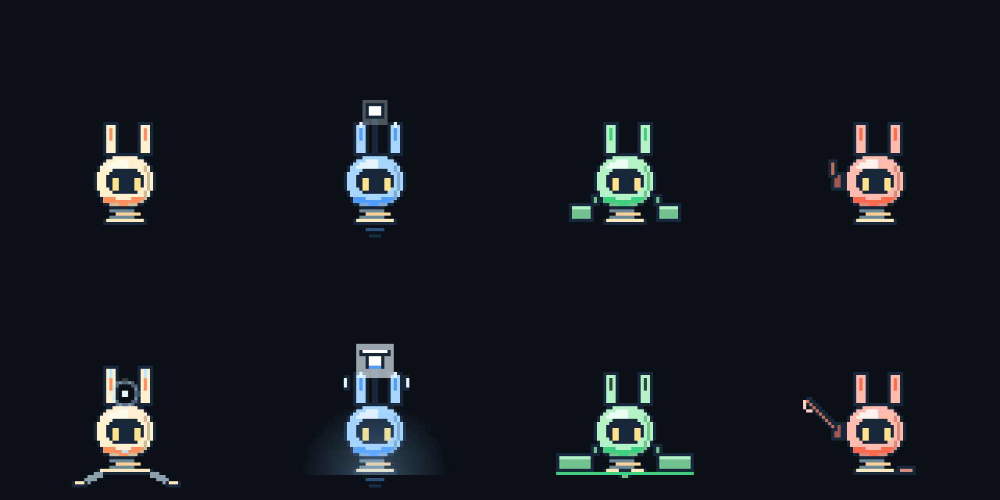
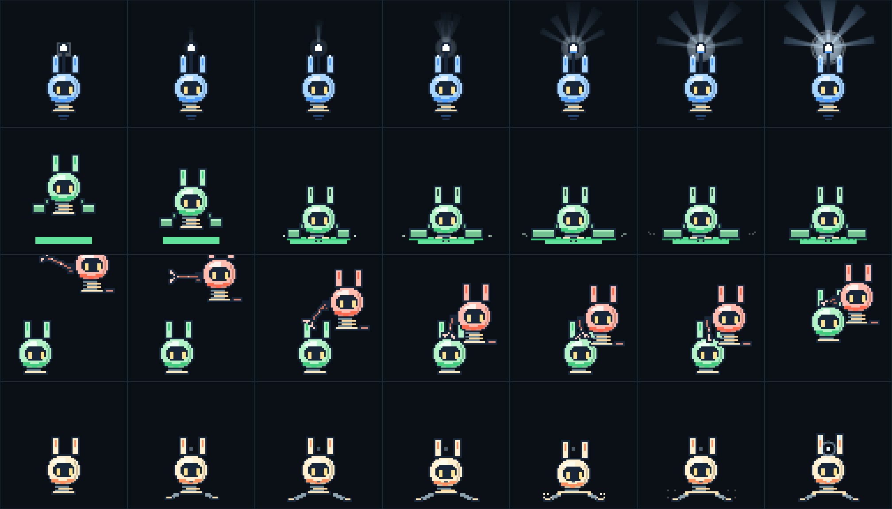

# RAPIPPO crew: same face, different job

Written spec for the four pods, from the P4 design notes (2026-11-03). The rule: **the face says "friends", the body says "job"**. Everyone shares the round head-body, the dark face panel with two eyes (no mouth) and the two rabbit-ear antennas. Colour and silhouette carry the role. Transformations change one or two parts, so they read in pixel art on a phone.

| Pod | Role | Normal silhouette | Transformed (when it works) | Habit |
|---|---|---|---|---|
| Rapippo | the beat, then the transmitter | tall and narrow, ears straight up, small spring base | **transmit tower**, played out in the silent beat after the dock: the spring legs fold out one pixel too far, pull back and **lock** (a pin at each hip, a spark at each foot, the spring presses down once), then the ears rise 2px into an antenna; from D+1 a light over the head and in the chest blink every 0.78s although it no longer hops | steady, exact hops |
| Blue | light, discovery, the first note | lightest; a **lamp on a stem above the ears**, lit ear tips, faint hover jet | **light mode**: the lamp stays small; the bulb brightens and **the light itself fans out** in five rays, wider and longer as it opens (outer rays last), with a ring leaving the lamp on each bell | floats high and soft |
| Green | stays, holds, the bass | **widest and lowest**: big foot pads on hip joints | **anchor (the bridge's root)**: drops onto its socket, the spring presses down (its weight on the plate), the pads swing 2px past their stop and settle, **bite the ground** (small teeth, a puff of dust each side), a strut drops from the belly, ear tips dim, green light underneath | low, heavy hops; slower to follow |
| Red | rescue, carrying, percussion | **asymmetric**: a folded crane arm on the left shoulder | **crane**: stowed it is small; working the crane it runs out a little. Going for green it **telescopes**: it points ahead in flight, red dips as it closes in and the arm reaches down to green's head with the hook open, the hook **shuts on the pickup**, and the pair climbs back up with green hanging from it | brisk take-off, quick landing |

## Implementation (STORY only)

- `public/src/story/crew.mjs` draws the role parts and the hero's transmit mode over the shared body from `public/src/pod.mjs`, which FREE RUN also uses and which is unchanged.
- **When each pod transforms** (`crewForm` in `story-app.mjs`):
  - Blue: for the dawn after assembly, and on its bell beats at its station.
  - Green: on the switch, and while playing at its station.
  - Red: half out while it works the crane and while it looks back; full while it flies and carries.
  - Rapippo: from the dock beat.
- **Check:** `tests/browser/story-crew.spec.mjs` renders all four in both forms and measures them from the pixels. At 1x: green is the widest (36px against 20–25), blue the tallest (lamp), red lopsided by 6px. When transformed: Rapippo +2px tall, blue wider, green +8px, red's reach +8px.

## Each transforms for someone else

Blue changes to light a world nobody knew; green to hold the road for the others; red to go back for a friend; Rapippo, last and only once, to send everyone's music home. Rapippo never transforms before the dock, so its one change is the end of the story.

## Priorities

- **A (done):** blue lamp; green wide feet; red's side arm; Rapippo's taller ears at the end.
- **B (done, rough):** blue's light circle; green's legs spreading; red's arm extending; Rapippo's head ring.
- **C (open, P4):**
  - ear angles for feelings (only green's droop when lost is done);
  - working lights;
  - small helper parts;
  - real pixel art and animation frames.
